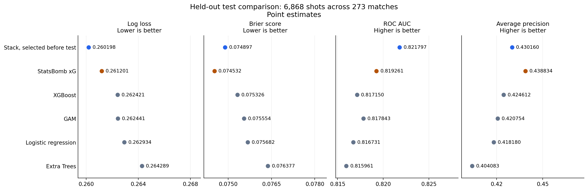

# Contextual xG

A Python expected goals model for non-penalty shots, built with StatsBomb open data from the 2015/16 season across five European leagues. The project compares four model families, combines them in a logistic regression stack, and uses the saved predictions to explore matches, individual chances and team attacking patterns.

The completed experiment covers 45,233 non-penalty shots across 1,823 matches. Its selected model, `stack_identity`, achieved a held-out test log loss of **0.260198** on 6,868 shots. The comparison with StatsBomb xG does not establish a clear performance advantage; see [test results](#test-results).

## Start with the notebooks

| Notebook | What it contains | Kernel |
| --- | --- | --- |
| [Match performance](match_analysis/chelsea_tottenham_2016.ipynb) | Chelsea 2–2 Tottenham, 2 May 2016: team summaries, shot maps, cumulative xG, chance rankings and freeze frames | Python, CPU sufficient |
| [Contextual shot explorer](shot_analysis/contextual_shot_explorer.ipynb) | Browse test shots, compare nearby chances, inspect goalkeeper and defender positions, and compare model probabilities | Python, CPU sufficient |
| [Team attacking profiles](team_analysis/team_attacking_profiles.ipynb) | Shot volume and quality, xG for and against, shot-pattern shares, team shot maps and match trends | Python, CPU sufficient |
| [Modelling notebook](notebooks/contextual_xg_ipynb.ipynb) | Data preparation, feature engineering, baselines, tuning, stacking, calibration selection and evaluation | Colab Python with GPU |

The three analysis notebooks work independently and read frozen test predictions. They do not need a running modelling notebook. Their saved outputs can be read on GitHub without executing code; live selectors require a notebook kernel with widget support.

For example, the match report compares Chelsea's 0.689 non-penalty xG with Tottenham's 2.460 despite the 2–2 score. The shot explorer examines why nearby shots can receive different probabilities when their surrounding players and preceding passes differ. These are descriptive comparisons, not causal explanations of the model.

## What is included

This repository contains the notebooks, configuration, exported evaluation tables and figures. **Fitted models, processed shot data and shot-level predictions remain outside the repository in the original Google Drive project.** There is currently no public artifact download bundle.

A clone is enough to read the saved outputs and aggregate results. Rerunning the analysis notebooks requires a copy of the original artifacts described below. The modelling notebook also provides a separate reproduction mode for rebuilding the experiment from the pinned public source.

```text
contextual-xg/
  README.md
  PROJECT_CONTEXT.md                  Detailed methodology and artifact inventory
  data_source.json                    Pinned source repository and commit
  modelling_config.json               Competition and split configuration
  notebooks/contextual_xg_ipynb.ipynb
  match_analysis/chelsea_tottenham_2016.ipynb
  shot_analysis/contextual_shot_explorer.ipynb
  team_analysis/team_attacking_profiles.ipynb
  results/                            Frozen manifest, metrics and evaluation figures
  LICENSE
```

## Run the analysis notebooks

1. Clone the repository and open a notebook in VS Code or Jupyter.

   ```bash
   git clone https://github.com/chihab46/contextual-xg.git
   cd contextual-xg
   ```

2. Select a Python kernel. CPU is sufficient for all three analysis notebooks. For local execution, use Python 3.11 or newer and a copy of the artifacts. For the original Drive setup, use a Colab Python kernel and mount Drive.

3. Install dependencies in the selected kernel if needed.

   ```python
   %pip install numpy pandas pyarrow matplotlib requests ipywidgets
   ```

   `ipywidgets` is optional for the selectors. The notebooks also contain static examples and direct plotting functions.

4. Set the artifact root before running the notebook's setup cells, or edit its `ARTIFACT_ROOT` setting.

   ```python
   import os
   os.environ["CONTEXTUAL_XG_ARTIFACT_ROOT"] = "/path/to/xg-python"
   ```

   The default is `/content/drive/MyDrive/xg-python`. This must point to the artifact project, not the Git checkout's `results/` folder.

5. Run the cells in order. Public match catalogues and selected match events download from the pinned source and are cached, so an internet connection is needed on first use. The notebooks verify the relevant frozen artifact hashes before analysis.

With the official VS Code Colab extension, choose **Select Kernel > Colab**. Drive mounting is available through **Colab: Mount Google Drive to Server...** in the command palette. See the [official extension guide](https://github.com/googlecolab/colab-vscode/wiki/User-Guide). Notebook cells execute remotely, so dependencies and artifact paths must exist on the selected Colab server.

### Required analysis artifacts

Use the original directory layout, replacing `<commit>` with `3bfbffe1de5750ebd47d770be0bb924a10cde54f`.

```text
<artifact-root>/
  matches.parquet
  data/processed/<commit>/
    features_stage_08.parquet
    features_stage_08.json
  models/<commit>/final_evaluation/
    frozen_manifest.json
    test_result.json
    test_model_predictions.parquet
```

| Notebook | Files needed from this tree |
| --- | --- |
| Match performance | The three files under `final_evaluation/` |
| Contextual shot explorer | All files shown |
| Team attacking profiles | All files shown except `features_stage_08.json` |

This tree supports the analyses. Resuming the modelling notebook requires the broader original project bundle, including fitted models, saved folds and validation references. See the [full artifact inventory](PROJECT_CONTEXT.md#runtime-paths-and-saved-artifacts).

The exported JSON files in `results/` preserve the original artifact paths and hashes. Keep them unchanged; copying them alone does not supply the missing prediction or model files.

## Resume or reproduce the model

The modelling notebook defaults to loading the completed experiment:

```python
RUN_MODE = "resume"
EXPERIMENT_ID = ""
SOURCE_PROJECT_DIR = Path("/content/drive/MyDrive/xg-python")
LOCAL_PROJECT_ROOT = Path("/content/xg-python")
```

Resume mode loads checkpoints and fitted models, verifies the saved validation predictions, and displays the recorded results. Training cells are skipped. Use a Colab GPU kernel for the strict CUDA XGBoost prediction check. A saved Colab run on 10 November 2026 reproduced all 6,555 validation predictions through the complete model chain, with maximum absolute difference `2.22e-16`.

For a separate rebuild, change the notebook's configuration to:

```python
RUN_MODE = "reproduce"
EXPERIMENT_ID = "reproduction-01"  # Choose a new, unused ID.
```

This mode reconstructs the experiment from the pinned public data and writes under `experiments/<EXPERIMENT_ID>/` in both local storage and Drive. It requires GPU training and substantial downloads. Nonempty experiment directories and existing frozen results are protected. The complete reproduction path has not been rerun since the notebook cleanup.

Set `SOURCE_PROJECT_DIR` and `LOCAL_PROJECT_ROOT` directly in the modelling notebook when using different locations. The analysis notebooks' `CONTEXTUAL_XG_ARTIFACT_ROOT` setting does not configure these paths.

### Modelling environment

The recorded experiment used Python 3.13.16, an NVIDIA Tesla T4, seed 42 and four CPU threads. The modelling notebook's dependency cell installs:

```python
%pip install --quiet \
    "numpy==2.4.6" "pandas==2.2.3" "scipy==1.16.3" \
    "scikit-learn==1.6.1" "xgboost==3.4.1" "pygam==0.12.0" \
    "pyarrow==23.0.1" "joblib==1.6.0" "threadpoolctl==3.7.0" \
    matplotlib requests tqdm
```

Run dependency installation before loading model state, and restart the kernel if installation requests it. Exact fitted settings, versions and hashes are recorded in the [frozen manifest](results/frozen_manifest.json).

## Data and modelling approach

The source is [StatsBomb open data](https://github.com/hudl/open-data), pinned in [data_source.json](data_source.json) to commit `3bfbffe1de5750ebd47d770be0bb924a10cde54f`. All competitions use the 2015/16 season, ID 27.

| Competition | ID | Matches |
| --- | ---: | ---: |
| Premier League | 2 | 380 |
| Ligue 1 | 7 | 377 |
| Bundesliga | 9 | 306 |
| Serie A | 12 | 380 |
| La Liga | 11 | 380 |
| Total | | 1,823 |

The pinned source matters, particularly for Bundesliga coverage. The experiment retains the 377 available Ligue 1 matches. Of 45,719 extracted shots, 45,233 meet the non-penalty eligibility rule. The target is whether the shot outcome is `Goal`; StatsBomb xG is a benchmark and never a predictor.

### Chronological evaluation

| Split | Match dates | Matches | Non-penalty shots |
| --- | --- | ---: | ---: |
| Train | Through 2016-02-28 | 1,279 | 31,810 |
| Validation | 2016-02-29 to 2016-04-10 | 271 | 6,555 |
| Test | 2016-04-11 to 2016-05-17 | 273 | 6,868 |

The notebook evaluates eight cumulative feature groups for each of logistic regression, a generalized additive model, XGBoost and Extra Trees, producing 32 baselines. The 67 raw predictors cover shot geometry, shot context, goalkeeper positioning, defensive pressure, obstruction, attacking support, final passes and preceding possession actions.

Validation log loss selects the feature stage for each family. Hyperparameter tuning uses five expanding chronological folds within training, with preprocessing fitted inside each fold and matches on the same date kept together. Possession features use only eligible actions before the shot.

The selected stack combines the four base-model probabilities through logit transformation, standardisation and logistic regression. Its meta-model uses chronological out-of-fold inputs. Identity calibration won the calibration comparison, so the final stack probabilities remain unchanged. The published test evaluation uses base models fitted on the training split, without a training-plus-validation refit.

## Test results

The frozen test set contains 6,868 non-penalty shots from 273 matches, including 713 goals. Lower log loss and Brier score are better; higher ROC AUC and average precision are better.

| Model | Log loss | Brier score | ROC AUC | Average precision |
| --- | ---: | ---: | ---: | ---: |
| Selected stack | 0.260198 | 0.074897 | 0.821797 | 0.430160 |
| StatsBomb xG | 0.261201 | 0.074532 | 0.819261 | 0.438834 |
| XGBoost | 0.262421 | 0.075326 | 0.817150 | 0.424612 |
| GAM | 0.262441 | 0.075554 | 0.817843 | 0.420754 |
| Logistic regression | 0.262934 | 0.075682 | 0.816731 | 0.418180 |
| Extra Trees | 0.264289 | 0.076377 | 0.815961 | 0.404083 |



The stack has the best log loss and ROC AUC point estimates; StatsBomb has the best Brier score and average precision. A paired bootstrap resampling whole matches, with 5,000 repetitions and seed 42, gives these 95% intervals for stack minus StatsBomb:

| Metric | Difference | 95% interval |
| --- | ---: | --- |
| Log loss | -0.001003 | [-0.005062, 0.002508] |
| Brier score | 0.000364 | [-0.000603, 0.001306] |

Both intervals include zero. These results do not establish a clear advantage over StatsBomb xG. See [the complete evaluation](results/test_result.json) for unrounded values and [the calibration plot](results/test_calibration.png) for probability calibration.

## Interpretation and limits

- The analysis notebooks describe the test window from 11 April to 17 May 2016. Team profiles cover 4–7 matches per team and should not be read as full-season rankings.
- Team volume metrics use matches played, including fixtures with zero non-penalty shots. They are per-match measures, not per-90 measures. Shot-pattern categories can overlap.
- Freeze frames show recorded visible players. Missing context differs from an observed absence of defenders or teammates. Coordinates use a 120 by 80 pitch; distances are pitch units, not metres.
- Comparing two shots or displaying base-model probabilities does not measure a feature's causal effect or provide additive feature contributions.
- The original test results have already been inspected. Further model development needs new independent evaluation for a fresh confirmatory claim.

See [PROJECT_CONTEXT.md](PROJECT_CONTEXT.md) for feature definitions, selection decisions, artifact recovery and development guidance.

## License and data credit

Project code and documentation are available under the [MIT License](LICENSE).

The football data comes from StatsBomb and is subject to its separate data terms. Credit StatsBomb when using the data or publishing derived analysis, and review the source project's [README](https://github.com/hudl/open-data) and [data license](https://github.com/hudl/open-data/blob/3bfbffe1de5750ebd47d770be0bb924a10cde54f/LICENSE.pdf).
